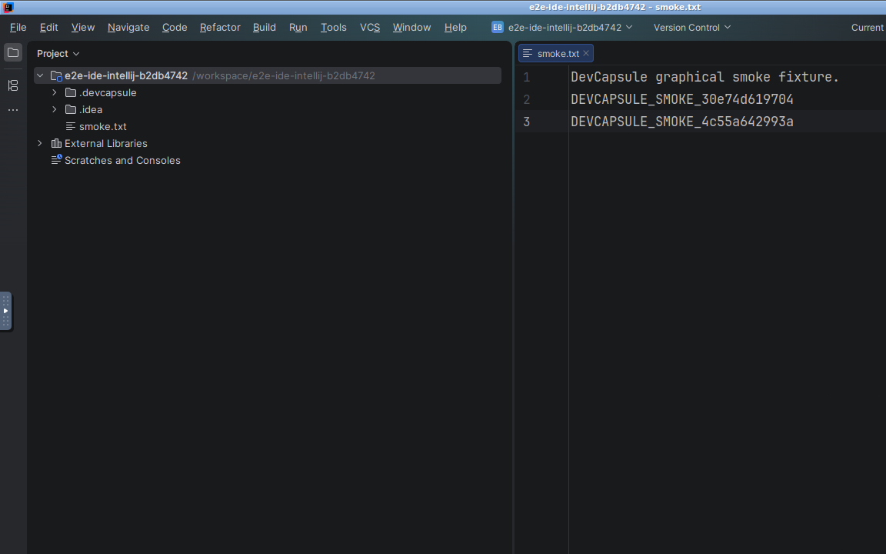

# DevCapsule

<!-- website:social title="DevCapsule: let your coding agent work, keep your workstation yours" description="Run Claude Code, Codex, or Antigravity without approving every routine step. Share one persistent container with a full IDE on Linux or Windows via WSL2, while host files stay outside by default." -->

<!-- website:hero -->
## Let your coding agent work. Keep your workstation yours.

Run Claude Code, Codex, or Antigravity without approving every routine
step. DevCapsule brings your agent, a full IDE, and your project's tools
together in one persistent container on your own computer.
**[Start here: open your first workspace](docs/getting-started/first-session.md)**
on Linux x86-64; on Windows, [read the WSL2 notes first](docs/platforms/windows-wsl2.md).

Your host home directory, SSH keys, and desktop session stay outside by
default. You decide what additional access to grant.

**The environment your agent tests in is the one you debug in.**

- Linux x86-64
- Windows via WSL2
- Apache-2.0
- Pre-V1

<!-- website:demo -->
### Watch a real session inside a capsule

Recorded inside a real DevCapsule container (`0.2.15` development build, 2026-10-04): IntelliJ IDEA Community reopens the `smoke` workspace after `devcapsule stop` and `devcapsule start`, preserves `smoke.txt` from the first session, and appends the second session marker (`2.6×` excerpt, 26 s; [full 68 s restart WebM](engineering-docs/blog/assets/2026-10-04-intellij/after-restart.webm) · [first-session 74 s WebM](engineering-docs/blog/assets/2026-10-04-intellij/first-session.webm) · [validation note](engineering-docs/implementation-notes/devcapsule/2026-10-04-intellij-playwright-validation.md)).

1. **0:00–0:06 — Reconnect to the restarted capsule desktop.** The Fluxbox desktop and IntelliJ IDEA Community reopen over noVNC after `devcapsule stop` and `devcapsule start`.
2. **0:06–0:15 — Verify preserved project state.** IntelliJ finishes indexing `smoke` and reopens `smoke.txt` with `first-session-ok` intact in the persistent container home.
3. **0:15–0:26 — Continue editing in the same environment.** The developer appends `after-restart-ok` in the editor and saves to the shared `/workspace` mount.

<!-- website:benefits -->
## Why switch to DevCapsule?

- **Give agents room to work.** Run Claude Code, Codex, or the Antigravity CLI without approving every routine command, behind a container boundary where your host home directory stays outside by default and extra mounts are explicit opt-ins. [What the capsule can touch](docs/containment/the-boundary.md)
- **Inspect and debug in the same environment.** Open PyCharm, IntelliJ IDEA, Eclipse, Rider, or VSCodium on the same workspace and toolchain the agent used—edit, run tests, inspect results, debug, or take over directly. [Your first session](docs/getting-started/first-session.md)
- **Come back ready to continue.** Stop for an hour or a month. Persistent container state, IDE settings, agent sign-ins, and file-based [workstream records](docs/collaboration/working-in-workstreams.md) let you or the next agent resume without rebuilding context from chat history. [Sessions](docs/sessions/start-stop-reconnect.md)

<!-- website:continuity -->
## Pick up where the last session stopped

When a developer or coding agent pauses work in DevCapsule, the handoff lives in a versioned status file in the repository rather than inside a chat window. Here is a real handoff excerpt from building DevCapsule (`0.3.0` release verification on `maintenance`):

- **What changed:** Repaired the automated GUI smoke harness and verified persistent workspace state across `devcapsule stop` and `devcapsule start` for IntelliJ IDEA, PyCharm, Eclipse, Rider, and VSCodium.
- **What was checked:** Full test suite (`557 passed`), documentation contract check (`docs-contract`), and recorded two-session persistence runs with saved screenshots and WebM videos.
- **What remains uncertain:** Cold first-import Maven indexing time on larger multi-module Java projects under constrained container CPU quotas.
- **Next action:** Publish the landing-page demonstration update and verify the rendered site across desktop and mobile viewports.

At the start of the next session, the incoming agent or developer reads [`CURRENT-STATUS.md`](CURRENT-STATUS.md) and the active workstream record before touching code—resuming with the same verified state, open questions, and next step ([read the workflow](WORKFLOW.md) · [browse the engineering journal](engineering-docs/blog/2026-09-30-what-i-have-been-up-to-lately.md)).

<!-- website:fit -->
## Is it for you?

### Good fit today

- You develop on Linux x86-64, or on Windows through WSL2, with Docker and
  Git already on your command line.
- You run one or more coding agents on real projects and want them fast
  without giving them your home directory.
- You like knowing exactly what a tool can touch, and you would rather read
  a bug record than guess.

### Not yet

- macOS: the executable is Linux-only and a port has not been started.
- ARM: not covered by this release.
- A polished experience: this is pre-V1. Expect edges, and expect every edge
  to have a file.

<!-- website:dogfood -->
DevCapsule is developed inside DevCapsule, by one person and several agents,
and the journal is the transcript. **We DO eat our own dog food.**

<!-- website:why -->
## Why DevCapsule?

A coding agent is most useful when it can edit files, run tests, and invoke project tools without stopping for permission at every command—and when you can step into that exact same environment with a full IDE whenever judgment, debugging, or inspection is needed.

### 1. Give agents room to work without risking your host

DevCapsule runs major coding agents (Claude Code, Codex, and the Antigravity CLI) inside an isolated container workspace. Let them edit files, run test suites, and use project tools at full speed without approving every routine step.

**Why is that safe?** Only your project checkout is mounted by default. Your host `$HOME`, SSH keys, browser profiles, and desktop session stay outside the capsule unless you explicitly grant access—and you can withdraw extra access when it is no longer needed. If an agent makes a mess of the workspace, Git is right there to inspect or revert it.

### 2. Inspect and debug in the same environment

Terminal output and diffs are not always enough. When a test fails or a design needs closer inspection, you should not have to reproduce the container's toolchain on your host laptop first.

Inside the same capsule, open a full IDE—PyCharm, IntelliJ IDEA, Eclipse, Rider, or VSCodium—sharing the exact files, compilers, runtimes, and test runners your agent just used. Set breakpoints, inspect variables, review diffs, or write code directly with zero per-project setup drift.

### 3. Come back ready to continue—and keep the fun

Switch tasks, change agents, or put a project aside for weeks—then return with both your container state (IDE layout, plugins, agent sign-ins, installed tools) and your engineering context preserved in versioned repository files.

Your AI helps with the minutiae: running checks, tracking requirements, recording design decisions, and keeping the next step explicit. You keep the judgment; AI helps with the bookkeeping.

**Less environment friction. More satisfaction in what you build.**

<!-- website:comparison -->
### But is it really needed?

Others solve parts of this; we tried them and found they fell a bit short of
our expectations. We’re building the combination we want—and using
DevCapsule to build DevCapsule. [See the detailed comparison](engineering-docs/design-notes/devcapsule/competitive-comparison.md).

<!-- website:contribute -->
## Contribute

Every open bug is a file under [engineering-docs/bugs](engineering-docs/bugs/)
with its evidence, and every workstream a status file that says what is next.
Pick a bug, work it with an agent inside DevCapsule, and send it back as a
pull request; the [developer brief](DEVELOPING.md) and the
[workflow](WORKFLOW.md) tell you what to read first. A one-page front door for
first contributions is coming; until then, an issue saying what you tried is
the right first message.

<!-- website:end -->

---

[Documentation](docs/README.md) · [For developers](DEVELOPING.md) · [Apache-2.0 license](LICENSE)
