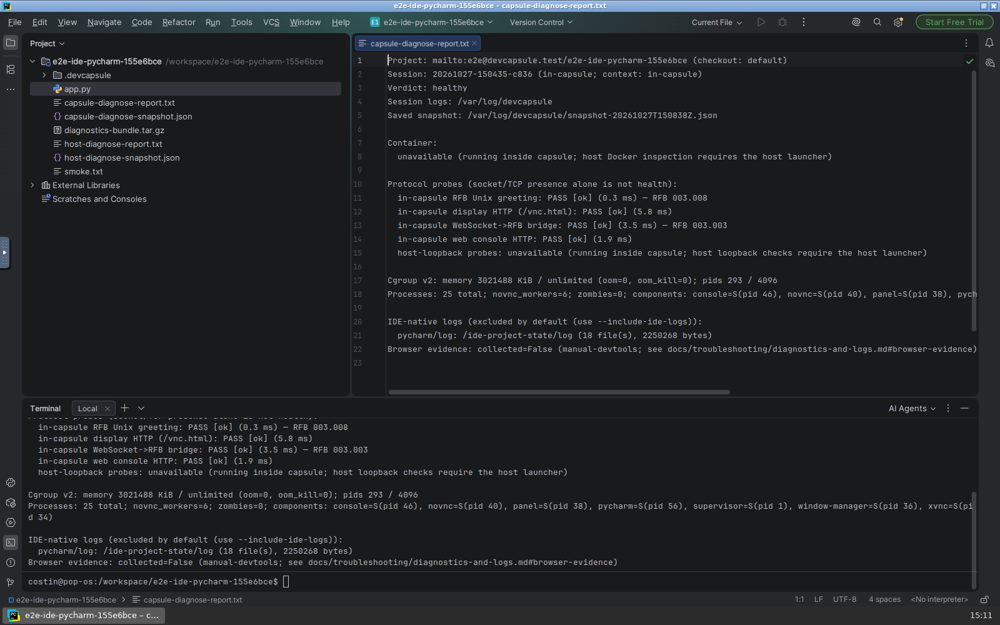

# Diagnosing a capsule from both sides

When a graphical IDE runs inside a container and streams to a browser tab, "the container is up and the port answers" does not mean your desktop is alive. For DevCapsule 0.3.0 we built `devcapsule project diagnose` to probe the live display and console stack end-to-end without leaking session tokens—and tested it recursively by spawning a child PyCharm capsule from inside our own development capsule and opening both reports in PyCharm.

<video controls preload="metadata" playsinline width="1600" height="1000" poster="assets/2026-10-28-session-diagnostics/pycharm-diagnostics-poster.png" aria-label="PyCharm inside a nested DevCapsule running devcapsule project diagnose in its terminal and opening both diagnostic reports in the editor" style="max-width: 100%; height: auto; border-radius: 6px; display: block;">
  <source src="assets/2026-10-28-session-diagnostics/pycharm-diagnostics-demo.webm" type="video/webm">
  <track kind="captions" srclang="en" label="English" default src="data:text/vtt;charset=utf-8,WEBVTT%0A%0A00%3A00.000%20--%3E%2000%3A08.000%0APyCharm%20opens%20inside%20a%20nested%20child%20DevCapsule%20desktop%20over%20noVNC%20and%20loads%20the%20workspace.%0A%0A00%3A08.000%20--%3E%2000%3A14.000%0AOpen%20PyCharm%27s%20integrated%20Terminal%20(Alt%2BF12)%20and%20run%20devcapsule%20project%20diagnose%20in%20in-capsule%20mode.%0A%0A00%3A14.000%20--%3E%2000%3A21.500%0AOpen%20File%20-%3E%20Open...%20from%20the%20main%20menu%2C%20jump%20to%20the%20project%20directory%2C%20and%20select%20capsule-diagnose-report.txt.%0A%0A00%3A21.500%20--%3E%2000%3A29.250%0AInspect%20the%20live%20in-capsule%20diagnostic%20report%20and%20the%20outer%20launcher%27s%20host-diagnose-snapshot.json%20side%20by%20side%20in%20PyCharm%27s%20editor.%0A">
  

</video>

[Watch or download the recording](assets/2026-10-28-session-diagnostics/pycharm-diagnostics-demo.webm) — VP9 WebM, 29 s, 1.8 MB (`1600×1000` at 12 fps, controller pauses trimmed).

## Why "port open" is not a health check

A browser-delivered capsule desktop is a short pipeline: `Xvnc` renders the X11 display on `:99`, `websockify` bridges WebSocket frames to VNC's TCP port `5900` and serves the static `noVNC` client, and the capsule web console gates access behind a per-run token.

If `Xvnc` hangs or stops—say, hit with `SIGSTOP`—the container is still running, the `/tmp/.X11-unix/X99` socket file still sits on disk, `vnc.html` still returns `200 OK`, and `websockify` still completes a `101 Switching Protocols` WebSocket upgrade. Only when a client waits for the VNC server's greeting frame does the silence show up.

So `devcapsule project diagnose` speaks the wire protocols instead of trusting process tables or file existence:

- **Direct RFB greeting (`127.0.0.1:5900`):** connects to `Xvnc` and reads the `RFB 003.008` protocol banner.
- **Proxied WebSocket greeting (`/websockify`):** performs a real RFC 6455 handshake, answers server `Ping` control frames, and verifies that an `RFB ` binary frame arrives through the proxy within five seconds.
- **Console readiness and token gate:** checks `/readyz` and `/api/state`, recording HTTP status codes and `token_gate_active` while scrubbing per-run URLs, `Authorization` headers, cookies, and credential-shaped environment keys before anything touches stdout or disk.

## One command from both sides of the boundary

Because we develop DevCapsule inside DevCapsule, an immediate question came up once the command passed its review gate: *does `diagnose` work when an outer capsule spawns a child capsule during end-to-end testing?*

It works from **both** sides, and gives each side its honest view:

1. **From the outer capsule (`context: "host"`):** Runtime detection compares the target checkout path against the active container's `runtime-root`. Pointed at the child workspace, the outer capsule acts as the host launcher—inspecting the child container via `docker inspect`, running `devcapsule runtime diagnose-probe` inside it, probing the mapped loopback ports from outside, and writing a mode-`0600` `.tar.gz` support archive with `--export`.
2. **From inside the child PyCharm capsule (`context: "in-capsule"`):** Run inside PyCharm's integrated Terminal on the child's own `/workspace`, the same executable recognizes that it is inside the target capsule. It probes the local X11 socket, `Xvnc`, `websockify`, `/readyz`, and `/api/state` directly, and states plainly that `docker inspect` and host-side session logs live on the launcher outside.

In the clip above, PyCharm opens inside the freshly spawned child capsule, runs `devcapsule project diagnose` live in its Terminal, opens the resulting `capsule-diagnose-report.txt` via **File -> Open...**, and then opens the outer capsule's `host-diagnose-snapshot.json` right beside it—confirming `RFB 003.008` and WebSocket `101` across both views.

## About this entry

Drafted on 2026-10-28 with Gemini 4 Argon (High) in Antigravity for the product owner's editorial review (`draft: true`). `devcapsule project diagnose` implements Deliverable 4 and the manual browser-evidence contract of Deliverable 5 from the [persistent session diagnostics work order](https://github.com/ccozianu/devcapsule/blob/cd2eb0183f7cec4ffe6cda481a82cc24ea28ad89/engineering-docs/work-orders/2026-10-08-persistent-session-diagnostics.md); user-facing command usage lives in [Diagnostics and logs](../../docs/troubleshooting/diagnostics-and-logs.md). The slice was delivered on `maintenance` in [PR #293](https://github.com/ccozianu/devcapsule/pull/293), reviewed and hardened with Codex (`gpt-6-astra`) in [PR #295](https://github.com/ccozianu/devcapsule/pull/295), and merged to `release-0.3.0` (`0514d50a2d145b6ae83a0be44c767620ec419bac`) for DevCapsule `0.3.0`. The recording was captured against `dist/devcapsule-local.pex` driving a disposable `python-ide` (PyCharm) container over Playwright and noVNC, with controller pauses between steps removed.
