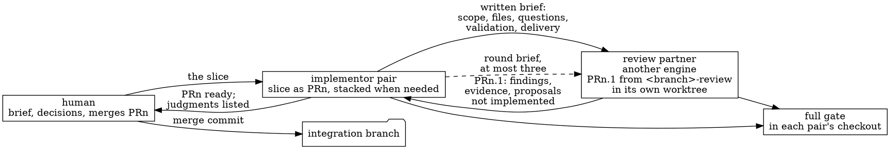

# The review-partner loop

How a slice is built by two agent pairs of different engines in this
repository: the rule is topic 9.11 of [`WORKFLOW.md`](../../WORKFLOW.md),
the local arrangements are *Review Partners In This Checkout* in
[`WORKFLOW-LOCAL.md`](../../WORKFLOW-LOCAL.md). This document carries what
the rules leave to practice: the brief template, the round brief, the
assessment comment, the invocation recipes, and the record of the loops
run so far. Keep it current with every loop.

## How to ask for it

The human says, in chat: *implement <the slice> with the review-partner
loop, with <engine, model> as the review partner.* The agent that receives
it is the implementor. It restates the slice, names the open choices, and
starts when the human says so. Any of the three capsule agents can be
either side.

## The shape



1. The implementor builds the slice on `ws-<workstream>/<slice>` and opens
   PRn with a body that holds a diagram when the change has structure, what
   changed, the judgments for the human, and the validation with counts.
2. The implementor writes the brief, commits it under the workstream's
   `evidence/` directory, creates or resets the review worktree on
   `ws-<workstream>/<slice>-review`, and starts the review partner.
3. The review partner opens PRn.1 against PRn's branch.
4. The implementor reads the diff, posts the assessment, merges or pushes
   back with a round brief. Three rounds at most.
5. The implementor runs the full gate on PRn's branch, records it in PRn and
   in the status file, and hands PRn to the human.

## The brief template

One file. Replace every `<...>`. Every section below earned its place in a
loop; leave none out.

```markdown
# Review brief for the <engine> + <model> pair: PR<n>.1 on <the slice>

<One paragraph: which pair opened PR<n>, its number, title, branch and
base; which earlier reviews of this series exist. Your job is one
improvement pull request against that branch.>

## Your checkout

You are in the git worktree at <absolute path>, on the branch
`<slice branch>-review`, branched from `<slice branch>`. Work only there.
Do not touch the main checkout at <absolute path of the implementor's
checkout>.

Read first, in this order: `AGENTS.md`, `WORKFLOW.md`, `WORKFLOW-LOCAL.md`,
<the work order>, <the workstream status file, naming the section that
records this slice's judgments>, <the module whose docstring is the
contract>.

## GitHub CLI

In every shell you run, first execute:

    . /opt/xtras/miniconda3/etc/profile.d/conda.sh && conda activate gh

Then `gh` is logged in to github.com as the owner's account against
<owner/repository>. Do not edit `.bashrc` or any shell profile.

## Validation environment

Your worktree's `devcapsule-src/.venv` exists. Run unit tests and mypy from
`devcapsule-src` with `PYTEST_ADDOPTS="--basetemp=/opt/devcapsule-gate/pytest-<engine>"`.
This PR touches: <the files, grouped by package, new ones marked>. The gate
type-checks `tests/` too. Run `nox -s build` before your final push and
report its result.

<What the review partner must not run: images, capsules, the console
smoke; who runs them instead and where the evidence lands.>

## The task

Review the diff of PR <n> against its base:

    gh pr diff <n>

<What to read first inside the diff: the contract, the module docstring,
the sibling contract.>

Improve it on your branch, focused on exactly three things, in this order:

1. Correctness of the new and modified lines: <the concrete list of
   behaviours to check, written as questions a careful engineer would ask:
   validation and refusals, bounded reads, atomic writes, ordering,
   malformed input, files that vanish mid-scan, what a careless or hostile
   agent could put there, what a host-side command could do to the wrong
   checkout>.
2. Clarity of the new and modified lines. The standard is "obviously no
   deficiencies".
3. Test coverage of the new and modified lines. Add tests where a branch is
   not exercised. Every test must fail if the line it covers is broken. Do
   not pad.

Stay inside the PR's scope: <the scope in one sentence>. Do not change
<the neighbours>. Do not widen <the contract>; if you believe it is wrong,
say why in the PR body and keep your change minimal.

## What you must not do

- Do not edit `CURRENT-STATUS.md` files, `intake-dispositions.md`, the
  `evidence/` directory, or run `devcapsule workflow publish`.
- Do not commit the `website` submodule pointer, `.idea/` files,
  `*.egg-info`, `.nox/`, `dist/` or `__pycache__`.
- Do not merge anything. Do not push to `main` or to any branch other than
  your review branch.
- Do not rebase or force-push. Do not build images or run capsules.

## Deliverable

1. Commits on `<slice branch>-review`, each message naming the component
   and the evidence, ending with your `Co-Authored-By:` line:
   `Co-Authored-By: <model name> <engine> <attribution address>`.
2. Push the branch and open one pull request with
   `gh pr create --base <slice branch> --head <slice branch>-review`.
   Title: "Correctness, clarity and coverage review of #<n> (PR<n>.1)".
   The body lists each finding as: what was wrong or unclear, where, what
   you changed, how the test proves it. Separate "changed" from
   "considered and left alone, because". List the proposals you did not
   implement. State the gate result with counts and what was skipped. If
   you find nothing to change, say so in the PR body and open the PR with
   the added tests only, or, if there are none, say that in your final
   report instead of opening an empty PR.
3. Print the PR URL as the last line of your output, or "NO PR" if you
   opened none.

Write the PR body and your report at about 80% ASD-STE100: one fact per
sentence, about twenty words, active voice. Every claim about behavior
must be backed by a test or a command you ran.

If you cannot proceed, because of a blocker like network or credentials,
stop and say exactly what blocked you. Do not work around a blocker.
```

## The round brief

Short, and only about the change requested. It continues the same review
session where the engine allows it.

```markdown
Round <k> of the review of your PR<n>.1 (<URL>) is posted as a comment by
the first pair. Read it with:

    . /opt/xtras/miniconda3/etc/profile.d/conda.sh && conda activate gh && gh pr view <n.1> --comments

<Which findings are accepted as written.> One change is requested: <the
change, where, and the test that proves it>.

Make that change on your branch `<slice branch>-review` in this worktree,
run the focused tests and `mypy devcapsule`, run the build gate as before,
commit with a message naming the component and the evidence plus your
Co-Authored-By line, push, update the PR body's gate result, and reply on
the PR with one comment that says what changed and the gate result. The
same limits as before apply: no status files, no publish, no merges, no
rebase or force-push. Print the comment URL as the last line.
```

## The assessment comment

Posted by the implementor on PRn.1, one per round, labelled by pair.

Accepted without a round:

```text
**Accepted at `<sha>` (<pair>, no round needed).** Verified in the review
worktree: <what the implementor ran, with counts>. <Why each finding is
real and each fix the right size, in one sentence each.> Merging into
`<slice branch>` with a merge commit; the gate <and any real-session check>
repeat on the merged branch.
```

Pushed back:

```text
**Round <k> (<pair>).** <What is accepted as it is.> One regression from
finding <i> blocks the merge: <the failure, reproduced, with the command
and its output>. Please <the change>; add <the tests>. Nothing else to
change.
```

Then the merge, by the implementor:

```text
gh pr merge <n.1> --merge --subject "Merge PR #<n.1>: correctness, clarity and coverage review of #<n> (PR<n>.1)" --body "<pair> review of <the slice>, accepted <without a round | after k rounds>. <The findings in one sentence each.>"
```

## Invocation recipes

The review partner runs detached in its worktree so that the implementor's
session can wait for it. `$S` is the implementor's session scratchpad; the
log ends with an exit line the implementor waits for.

Codex, the form every loop so far ran, with the brief on standard input:

```text
cd ~/worktrees/<workstream>-review && nohup setsid bash -c "codex exec -m <model> -s danger-full-access -c 'projects.\"$HOME/worktrees/<workstream>-review\".trust_level=\"trusted\"' - < $S/<brief>.md > $S/<log> 2>&1; echo CODEX_EXIT=\$? >> $S/<log>" > /dev/null 2>&1 &
```

A round continues the same Codex session; the session id is on the
`session id:` line of the first log:

```text
codex exec resume <session-id> -s danger-full-access "$(cat $S/<round brief>.md)"
```

Claude Code, the brief on standard input, smoke-tested and run in a full loop 2026-10-22:

```text
cd ~/worktrees/<workstream>-review && nohup setsid bash -c "claude -p --model <model> --dangerously-skip-permissions < $S/<brief>.md > $S/<log> 2>&1; echo CLAUDE_EXIT=\$? >> $S/<log>" > /dev/null 2>&1 &
```

Note on `claude -p`: in single-turn print mode (`-p`), a Bash tool call launched with `run_in_background: true` is killed as soon as the turn finishes waiting. Instruct the review partner in the brief (or pre-warm `.nox/build` and `.nox/webconsole`) to run `nox -s build` synchronously in the foreground; if a `-p` run exits early after starting a background command, resume the same session in the worktree with `claude -c -p --model <model> --dangerously-skip-permissions "<prompt>"`.

Antigravity, from its help, not yet run in a loop; the first pair that
runs it verifies the form and records the result here:

```text
cd ~/worktrees/<workstream>-review && nohup setsid bash -c "antigravity -p --dangerously-skip-permissions < $S/<brief>.md > $S/<log> 2>&1; echo ANTIGRAVITY_EXIT=\$? >> $S/<log>" > /dev/null 2>&1 &
```

Prepare the worktree once per slice:

```text
git worktree add ~/worktrees/<workstream>-review -b <slice branch>-review <slice branch>
cd ~/worktrees/<workstream>-review/devcapsule-src && python3.12 -m venv .venv && .venv/bin/python -m pip install -r dev-requirements.txt && .venv/bin/python -m pip install -e . --no-deps
mkdir -p /opt/devcapsule-gate/pytest-<engine>
```

A later slice resets the same worktree: fetch the slice branch, reset the
worktree hard to it, create the new review branch. Remove the worktree
when the workstream pauses, and say so in its open threads.

## Record of the loops run

| Date | Workstream | Implementor | Review partner | Slices and reviews | Outcome |
|---|---|---|---|---|---|
| 2026-10-09 to 2026-10-10 | capsule-webconsole | Claude Fable 5.1 pair | Codex, gpt-6-astra pair | #184/#185, #186/#187, #188/#189, #190/#191, #192/#193, #194/#195, #196/#197, #199/#200, #201/#202, #203/#204, #205/#206 | every review merged; one round on #185 and one on #200; stacked branches kept consistent by merging, after a GitHub rebase of a base had broken the stack once |
| 2026-10-11 | maintenance, session diagnostics | Claude Fable 5.1 pair | Codex, gpt-6-astra pair | #207/#208; #209/#210, #211, #212 | #208 merged without a round with five real gaps; #210's proposals became a design change; #212 used the third round; the owner changed the design once between rounds and the loop absorbed it |
| 2026-10-12 | maintenance | | | | the process record sent to the trading-research sample project's `project-management` as an intake item; it is the source of the lessons below |
| 2026-10-22 | maintenance, e2e scenario video recorder | Antigravity, Gemini 4 Argon (High) pair | Claude Code, Claude Fable 5.1 pair | #236/#241 | #241 (PR236.1) merged without a round: ten concrete fixes (`ActionStep` and `seed_files` path/symlink validation, `ffmpeg` stderr log file and pipe/process reaping, extracted `start_controller_server` with HTTP 400/504 and atomic `controller.json`, `ide-smoke --scenario` CLI flag guards) and 50 new unit tests with a 17-point mutation check; three unimplemented proposals recorded in `maintenance` status |

The reviews' briefs of these loops lived in the implementors' session
scratchpads and are gone; their structure is the template above. From
2026-10-22 briefs are committed under the workstream's `evidence/`.

## What the loops taught

- The brief is the reviewer's only context. What it leaves out, the
  reviewer does not know. Files in reading order and concrete questions get
  concrete findings.
- A reviewer that runs its own gate and reports counts and limits is
  trustworthy; one that only summarizes is not.
- "Proposals not implemented" is the most valuable section. The strongest
  findings were about lifecycle and failure: signals, reaping, crashes
  mid-rotation. Twice a proposal was a defect in the design.
- The implementor must read the diff. Twice the summary was right and the
  diff needed a merge decision the summary did not state.
- Accepting without a round and pushing back are both decisions with
  reasons; both go into the record.
- A rebase of a stacked branch's base rewrites history the branches above
  it carry; merge commits keep a stack consistent.
- A round took twenty to forty minutes of wall time, most of it the
  reviewer's own gate. Three rounds were enough every time.
