# 0.3.0 user documentation CLI alignment, full stub authoring, and prose review: maintenance assignment

Date: 2026-10-30
From: project-management
To: maintenance
Authority: explicit product-owner assignment and web-console decisions `write-full-pages`, `combine-with-language`, and `direct-wo-pair-batches` (`2026-10-30T02:29:31+00:00`).

## What is handed over and why

The owner assigned `maintenance` on `release-0.3.0` to audit and update every Markdown page in `docs/` (`49` `.md` files on `release-0.3.0`) file by file for **0.3.0**, closing final-tag gate **C16** and the October 24 language-review booking (`2026-10-24-maintenance-docs-language-review-before-0-3-0.md`, now acknowledged and folded in) in one pass:

1. **`write-full-pages`:** Author complete `0.3.0` content for all `12` `status: planned` stubs in `docs/`, leaving zero `"Coming soon"` pages in `0.3.0`, without inventing unshipped commands (automated cleanup stays in `0.3.1`).
2. **`combine-with-language`:** Check and rewrite every file once for both `0.3.0` CLI/runtime truth and clear human-English prose. Keep the October 25 new-page/recipes proposals (`2026-10-25-documentation-orientation-and-concepts.md`) deferred to `0.3.1`.
3. **`direct-wo-pair-batches`:** Execute in coherent batches of **at most 10 `docs/*.md` files per pull request** targeting `release-0.3.0`, using **Pair Review** with Antigravity (`Gemini 4 Argon (High)`) as implementor and Codex (`gpt-6-astra`) as review partner on every batch PR. Do not touch `docs/versions.yaml`.

Canonical order: `engineering-docs/work-orders/2026-10-30-user-docs-0-3-0-cli-alignment.md` at `b89d947ebc70d7bf6c8aa4e1514f2724273f94f5` (mainline PR [#316](https://github.com/ccozianu/devcapsule/pull/316); merged into `origin/ws-project-management/coordination` at `1304358e7e9cdecd33f83ad15c73e63c699e9857`). The complete binding work order follows below.

## What acknowledging means

Take and acknowledge this order in `maintenance`'s status and `0.3.0` release overview on `release-0.3.0`, and execute the five `<= 10`-file Pair Review batches (`Antigravity` + `Codex / gpt-6-astra`) against `release-0.3.0` using the built `release-0.3.0` executable and an initialized `website` submodule (`npm --prefix website run check:content`). Do not cherry-pick between `release-0.3.0` and workstream branches.

---

# Work Order: 0.3.0 User Documentation CLI Alignment, Full Stub Authoring, And Prose Review

Origin: product-owner direction on 2026-10-30 and web-console decisions
`write-full-pages`, `combine-with-language`, and `direct-wo-pair-batches` at
`2026-10-30T02:29:31+00:00`.
Status: assigned; implementation and acceptance remain outstanding.
Coordination owner: `project-management`. Implementation owner: `maintenance`
on `release-0.3.0`.
Pair Review assignment: Antigravity (`Gemini 4 Argon (High)`) implements;
Codex (`gpt-6-astra`) is the review partner.
Target: **0.3.0** (closes final-tag gate **C16** and the October 24 language
review booking).
Requirements:
[R-DOCS-002](../requirements/product/r-docs-002-current-user-docs-show-current-interfaces.md),
[R-DOCS-003](../requirements/product/r-docs-003-website-content-carries-front-matter.md),
and [the content–website contract](../specifications/product/content-website-contract.md).

```dot
digraph docs_030_batches {
  rankdir=LR;
  node [shape=box];

  inv [label="49 docs/*.md files\non release-0.3.0\n(37 authored + 12 planned)"];
  batches [label="5 coherent batches\n<= 10 docs/*.md files per PR\n(no directory split)"];
  impl [label="Antigravity\n(Gemini 4 Argon (High))\nfile-by-file 0.3.0 CLI audit,\nauthor planned pages, human prose\nopens PRn -> release-0.3.0"];
  rev [label="Codex (gpt-6-astra)\nisolated -review worktree\nfile-by-file CLI & prose check\nopens PRn.1 -> slice branch"];
  gate [label="Gate per batch:\nbuilt 0.3.0 CLI verification\ninitialized website check:content\nnox -s build"];
  merge [label="Human review & merge\n(<= 10 docs files per PR)\ninto release-0.3.0", shape=folder];

  inv -> batches -> impl;
  impl -> rev [label="written brief +\nper-file ledger"];
  rev -> impl [label="PRn.1 (<= 3 rounds)"];
  impl -> gate;
  rev -> gate;
  gate -> merge;
}
```

## Outcome

Every Markdown page under `docs/` on `release-0.3.0` (`49` `.md` files)
accurately describes the shipped `0.3.0` CLI, configuration files, capabilities,
and runtime behavior. All `12` `status: planned` stubs are written in full for
`0.3.0`, leaving zero `"Coming soon"` pages in `docs/`. Every page reads as
clear, direct prose written for humans rather than machine-generated filler.

To keep human review tractable, work lands through **Pair Review** in coherent
pull requests that each touch **at most 10 `docs/*.md` files**.

## Binding decisions

- **Author all 12 planned pages (`write-full-pages`).** Write complete `0.3.0`
  documentation for all `12` `status: planned` pages in `docs/`, remove
  `status: planned` from their front matter, and set `updated`. Do not leave
  stub pages in `0.3.0`, and do not invent unshipped commands or pull in
  features deferred beyond `0.3.0`.
- **Combine CLI alignment and human-English prose cleanup (`combine-with-language`).**
  This order acknowledges and absorbs the October 24 language-review booking
  (dispositioned in
  [intake-dispositions.md](../wip/2026-08-09-project-management/intake-dispositions.md)).
  Review every file once for both `0.3.0` technical accuracy and clear human
  prose so the owner does not review two separate `49`-file passes.
- **Keep the October 25 new-page proposals in `0.3.1`.** The new pages,
  recipes area, glossary page, and landing-page changes in
  [the October 25 work order](2026-10-25-documentation-orientation-and-concepts.md)
  remain deferred to `0.3.1` per
  [the candidate-8 scope record](../wip/2026-08-09-project-management/2026-10-27-decision-release-0-3-0-scope-at-rc8.md).
  Do not add new `docs/` files or amend `website/CONTRACT.md` in this order.
- **Direct work-order issuance; Pair Review on every batch (`direct-wo-pair-batches`).**
  `project-management` issues this order directly via mainline PR and
  coordination mail to `maintenance`. Execution runs on `release-0.3.0` under
  `maintenance`, using [Pair Review](../development/review-partner-loop.md) with
  Antigravity (`Gemini 4 Argon (High)`) as implementor and Codex
  (`gpt-6-astra`) as review partner on every batch PR.
- **Hard cap of 10 `docs/*.md` files per pull request.** Group files by
  directory into batches of `<= 10` `docs/*.md` files. If newly authored pages
  make a batch heavy to read, `maintenance` may split that batch into two
  smaller PRs; it may never exceed `10` `docs/*.md` files in one PR.

## Repository evidence used

Inspected at `origin/release-0.3.0` (`000c86561ea80b492717efc5178545e8f61e5e7a`)
and `origin/main` (`27f24fc6a104c28a6e25fd3e80c6d4950f66b392`):

- **Inventory divergence between `main` and `release-0.3.0`.** `docs/` holds
  `48` `.md` files on `main` and `49` `.md` files on `release-0.3.0` (which
  added `docs/configuration/home.md` in PR #299), plus `docs/versions.yaml`.
  Execution must branch from and target `release-0.3.0`, where both the `49`
  files and the `0.3.0` CLI implementation live.
- **Page currency on `release-0.3.0`.** Of the `49` `.md` files, `12` are
  8-line `status: planned` stubs, `14` still carry `updated: 2026-09-28` from
  the `0.2.15` migration, and `8` carry `2026-10-24` or `2026-10-25` dates that
  predate `devcapsule home`, schema-2 manifests, VS Code, `project diagnose`,
  and `project run --ide IDE --force`.
- **Concrete drift even on recently touched pages.** `docs/reference/cli.md`
  (`updated: 2026-10-29`) omits `devcapsule project diagnose` (merged in
  PR #293) from both the `devcapsule project` table and `Other project commands`.
  `docs/working-with-ai/review-and-change-agents.md` refers to `"the three
  agents"` as a stub without naming the `0.3.0` capability spellings.
- **`0.3.0` capability catalog (`devcapsule/resolution_matrix.py`, `_MATRIX_VERSION = "embedded-29"`).**
  Six IDE capabilities (`python-ide` -> `pycharm`, `java-ide` -> `intellij`,
  `eclipse-ide` -> `eclipse`, `dotnet-ide` -> `rider`, `frontend-ide` ->
  `codium` or `vscode`, `vscode-ide` -> `vscode`), three coding-agent
  capabilities (`codex-agent` -> `codex`, `claude-code-agent` -> `claude-code`,
  `antigravity-agent` -> `antigravity-cli`), three component tools/SDKs
  (`postgresql-client`, `browser-automation` -> `playwright`, `dotnet` ->
  `dotnet-sdk`), and five base-supplied capabilities (`python`, `node`, `java`,
  `maven`, `docker-cli`).
- **Release-branch `docs/versions.yaml` rule.** Commit `da253875` on
  `release-0.3.0` preserves the release-only `source-version: 0.3.0` line on
  the `devel` entry. Batch PRs must not edit `docs/versions.yaml`;
  [release documentation automation](2026-10-27-release-documentation-automation.md)
  updates the manifest at final-tag time.
- **Silent skip hazard in `nox -s docs-contract`.** In `devcapsule-src/noxfile.py`,
  `check_docs_contract` logs `"website submodule not initialized; skipped"` and
  exits `0` when `website/package.json` is absent. Both implementor and
  reviewer checkouts must initialize the `website` submodule and verify that
  `npm --prefix website run check:content` actually runs.

## Deliverables and completion conditions

### 1. File-by-file `0.3.0` CLI and runtime audit across all 49 pages

Verify every command, subcommand, option, exit status, file path, TOML snippet,
environment variable, and capability or component name in each file against the
built `release-0.3.0` executable (`devcapsule-src/.venv/bin/devcapsule` and
`dist/devcapsule-local.pex`, never the older host `devcapsule0` binary). Check
every page against the `0.3.0` changes delivered by:

- [CLI UX redesign](2026-10-24-cli-ux-redesign.md),
  [capabilities and components](2026-10-24-capabilities-and-components.md), and
  [manifest schemas](2026-10-26-manifest-schemas-as-classes.md):
  - `project init --require 'NAME[>=VERSION]' --offer CAPABILITY --ide IDE --with CAPABILITY --regenerate` (schema-2 `.devcapsule/devcapsule.toml`; retire `--need` and `--local`).
  - `project config` read-only commands: `show`, `check [--manifest FILE --lock FILE]`, `env list`, `docker-args list`, `trust list`, `console list`.
  - `project config` checkout commands: `ide`, `add`, `omit`, `restore`, `use CAPABILITY COMPONENT|default`, `set NAME VALUE|default`, `authorize NAME VALUE [JUSTIFICATION] [--all-recommended]`, `deny`, `forget`, `approve [NAME...|--all]`, `env set|unset`, `docker-args set|clear`, `bind`, `unbind`, `console apply|discard`, and recovery-only `capabilities --recover`.
  - `project config` owner commands (writing schema 2, supporting `--preview`): `require`, `require env`, `offer`, `offer env`, `drop [env]`, and `recommend` (`ide`, `memory`, `cpus`, provider resolution, and host-access recommendations with `--because`).
  - Retired spellings (`config list`, `config resolve`, `config need`, `config agent`, `config tool`, mutating `project config default|trust`) must not appear as active instructions; where migration guidance helps, state that retired spellings exit `2` without writing and print their replacement.
- [Configuration home and `home` commands](2026-10-27-configuration-home-and-the-home-commands.md):
  - `devcapsule home show`, `home default memory|cpus VALUE|none`, and `home trust list|accept|withdraw` run from any directory without a project.
  - `DEVCAPSULE_CONFIG_HOME` names a self-contained configuration, data, state, and cache home; unset defaults use the four XDG directories.
  - `settings.toml` holds home defaults, trusted channels, format version, and `minimum-devcapsule`. Inside a capsule, `home` reads the read-only launcher settings until the first write creates capsule-local settings.
  - Remove remaining `"workstation"` wording (`workstation.toml`, `trust.toml`, `"this workstation"`) in favor of `"this DevCapsule home"` or `"this computer"`.
- [Explicit IDE requirement override](2026-10-28-explicit-ide-requirement-override.md) and VS Code support (PR #301):
  - `project run` one-launch flags (`--ide`, `--with`, `--use CAPABILITY=COMPONENT`, `--memory`, `--cpus`, `--env`, `--trust`, `--authorize`, `--set`, `--save`, `--print-command`, `-- DOCKER-RUN-OPTIONS...`) and status `3` (`DecisionPending`) when non-interactive decisions remain.
  - `project run --ide IDE --force` for a one-launch departure from a required IDE (never with `--save`, never skipping trust, consent, integrity, or dependency checks).
  - Six IDE capabilities including `vscode-ide` and `vscode` as the second provider of `frontend-ide` (VSCodium remains default).
- [Persistent session diagnostics](2026-10-08-persistent-session-diagnostics.md),
  [checkout environment](2026-10-23-checkout-environment.md),
  [saved Docker arguments](2026-10-23-saved-docker-arguments.md), and
  [the capsule web console](2026-10-09-capsule-webconsole.md):
  - `devcapsule project diagnose [--session ID] [--export [PATH]]` documented in `docs/reference/cli.md`, `docs/troubleshooting/diagnostics-and-logs.md`, and cross-linked where relevant.
  - `devcapsule project checkout` (`register`, `notifications list|post|read|dismiss`, `decisions from-table|check|hand-off`) and console request confirmation (`project config console list|apply|discard`).
- **Content-contract invariants on every edited page:**
  - Valid YAML front matter (`description`, optional `weight`, `role` preserved on all distinguished role pages, `updated` set to the edit date).
  - Zero literal DevCapsule version strings matching `v?0\.\d+\.\d+(\.dev\d+)?`; use `{{version}}`, `{{tag}}`, `{{release_url}}`, and `{{download_url}}`.
  - Valid shell syntax in fenced `sh`/`bash` blocks and resolving relative internal links.

### 2. Full `0.3.0` authoring of the 12 `status: planned` pages

Replace all `12` `status: planned` stubs with complete, verified `0.3.0` pages,
removing `status: planned` and adding `updated`:

| Page | Required `0.3.0` scope and guardrails |
| --- | --- |
| `docs/reference/project-info.md` | Document every section and field of `devcapsule project info` and `project info --json`, and explain how inside-capsule output (captured launch context) differs from host output. Verify against actual `release-0.3.0` output. |
| `docs/troubleshooting/cleanup-and-uninstall.md` | Document inspecting and reclaiming disk space from Docker images (`devcapsule images list`, `docker image rm`), caches, removing one checkout's persistent state (`project info` paths), and removing the `devcapsule` binary and home (`home show`, `DEVCAPSULE_CONFIG_HOME` / XDG roots). **Guardrail:** automated image/cache cleanup CLI moved to `0.3.1`; do not invent a cleanup subcommand. |
| `docs/configuration/ide-preferences.md` | Document per-checkout IDE configuration, plugin, and extension persistence across the six IDE surfaces, separate per-IDE state namespaces (preserved across `run --ide ... --force`), `project state adopt`, and declared `config bind`/`unbind` directories. |
| `docs/your-project/declare-needs.md` | Document schema-2 `.devcapsule/devcapsule.toml` (`[capabilities] required/optional` with `NAME>=VERSION`, `[capabilities.resolution]`, `[environment] required/optional`, `[recommendations]`), the platform lock, `project init --regenerate` migration from schema 1, and why recommendations ask rather than grant. Reuse definitions from `docs/configuration/index.md`. |
| `docs/your-project/services-and-ports.md` | Document running databases or companion services beside a project, declaring connection variables with `config require env` / `offer env`, supplying values with `config env set`, bridge vs authorized `network host`, and publishing ports with `config docker-args` or `run -- -p`. |
| `docs/sessions/several-projects.md` | Document concurrent capsules across multiple repositories or multiple checkouts/worktrees of one repository, `project list`, `project checkout register NAME`, isolated per-checkout state, distinct desktop and web-console URLs, and separate `DEVCAPSULE_CONFIG_HOME` homes when needed. |
| `docs/sessions/another-machine.md` | Document moving a project to a second computer: what travels in Git (manifest, platform locks, workflow and status records), what you answer in the new home (`home trust`, `config ide`, `config env`, host authorizations), and carrying or adopting state (`project state adopt`). |
| `docs/everyday-development/git.md` | Document committing, pushing, and pulling inside the capsule, Git identity in the persistent capsule home, why host SSH keys and credential stores stay outside the boundary by default, safe ways to authenticate from inside the capsule, and agent co-authorship trailers. |
| `docs/everyday-development/run-debug-test.md` | Document building, running, testing, and debugging inside the capsule across the catalog IDEs and integrated terminals, sharing one toolchain (`python`, `node`, `java`/`maven`, `dotnet`, `playwright`, `postgresql-client`) with capsule agents. |
| `docs/everyday-development/previews-and-ports.md` | Document opening a web app running in the capsule from the contained browser or host browser: port publishing on bridge networking (`127.0.0.1` bindings via `docker-args` or `run --`), authorized `network host`, and `host-browser` opener behavior. Keep focused on everyday development rather than duplicating `your-project/services-and-ports.md`. |
| `docs/working-with-ai/hosted-and-local-models.md` | Document using the three catalog coding agents (`claude-code-agent`, `codex-agent`, `antigravity-agent`) with provider sign-ins in the persistent capsule home, passing API keys/endpoints via `config env set`, and reaching a local model endpoint across the container network boundary without naming unverified third-party products. |
| `docs/working-with-ai/review-and-change-agents.md` | Document inspecting an agent's work with Git and IDE diffs, running project checks before committing, and adding, omitting, or switching among `claude-code-agent`, `codex-agent`, and `antigravity-agent` (`config add`, `config omit`, `run --with`) on one checkout without losing project or home state. |

### 3. Human-English prose and section-entry clarity

Apply the standards from the October 24 language-review booking to every page:

1. Write direct prose that a human engineer writes for another human. Cut
   machine-prose habits: throat-clearing openings, naming a concept and
   immediately restating it, abstract filler, and passive hedging.
2. Verify each directory's entry page (as linked from `docs/README.md`, plus
   `docs/configuration/index.md`) states the section's core concept in plain
   words before sub-pages dive into flags and edge cases.
3. Keep product terminology consistent with `docs/configuration/index.md`
   (capsule, capability, component, IDE, manifest, platform lock, checkout
   record, home settings, boundary, authorization, trust). Do not name
   unbundled third-party products in `docs/`.

### 4. Five-batch pull-request plan (`<= 10` `docs/*.md` files per PR)

Execute the `49` Markdown files in five coherent batches on `release-0.3.0`.
No directory is split across batches, and Batch 1 settles the reference pages
first so later batches link to stable headings and spellings. Do not touch
`docs/versions.yaml`.

| Batch | Branch stem (`ws-maintenance/...`) | Directories & files (`docs/*.md` count) | Planned stubs authored |
| --- | --- | --- | --- |
| **1** | `0.3.0-docs-batch-1-reference-updates-troubleshooting` | `docs/reference/` (`cli.md`, `configuration-nodes.md`, `project-info.md`), `docs/updates/` (`component-freshness.md`, `component-upgrades.md`, `launcher-updates.md`, `supported-versions.md`), `docs/troubleshooting/` (`first-session.md`, `diagnostics-and-logs.md`, `cleanup-and-uninstall.md`) — **10 files** | `2` (`project-info.md`, `cleanup-and-uninstall.md`) |
| **2** | `0.3.0-docs-batch-2-configuration` | `docs/configuration/` (`index.md`, `home.md`, `capabilities.md`, `project-versus-personal.md`, `software-approvals.md`, `resource-limits.md`, `inspect.md`, `ide-preferences.md`, `extra-tools.md`, `local-base.md`) — **10 files** | `1` (`ide-preferences.md`) |
| **3** | `0.3.0-docs-batch-3-onboarding-platforms-containment` | `docs/README.md`, `docs/getting-started/` (`install.md`, `first-session.md`, `stop-and-come-back.md`), `docs/platforms/` (`linux.md`, `macos.md`, `windows-wsl2.md`), `docs/containment/` (`the-boundary.md`, `granting-and-withdrawing.md`) — **9 files** | `0` |
| **4** | `0.3.0-docs-batch-4-project-sessions-collaboration` | `docs/your-project/` (`new-project.md`, `existing-repository.md`, `declare-needs.md`, `services-and-ports.md`), `docs/sessions/` (`start-stop-reconnect.md`, `what-persists.md`, `web-console.md`, `several-projects.md`, `another-machine.md`), `docs/collaboration/` (`working-in-workstreams.md`) — **10 files** | `4` (`declare-needs.md`, `services-and-ports.md`, `several-projects.md`, `another-machine.md`) |
| **5** | `0.3.0-docs-batch-5-everyday-and-ai` | `docs/everyday-development/` (`ides-and-terminals.md`, `git.md`, `run-debug-test.md`, `previews-and-ports.md`, `clipboard-and-browser.md`), `docs/working-with-ai/` (`choose-an-agent.md`, `sign-in-and-defaults.md`, `instructions-for-agents.md`, `hosted-and-local-models.md`, `review-and-change-agents.md`) — **10 files** | `5` (`git.md`, `run-debug-test.md`, `previews-and-ports.md`, `hosted-and-local-models.md`, `review-and-change-agents.md`) |

If authoring four or five formerly `status: planned` pages in Batch 4 or Batch 5
produces a large line diff, split that batch by directory (for example,
`everyday-development/` as `5` files and `working-with-ai/` as `5` files) so
each PR remains quick for the human to review.

### 5. Pair Review execution protocol (`Antigravity` + `Codex / gpt-6-astra`)

Follow topic 9.11 of [`WORKFLOW.md`](../../WORKFLOW.md), *Pair Review Loop In
This Checkout* in [`WORKFLOW-LOCAL.md`](../../WORKFLOW-LOCAL.md), and
[`review-partner-loop.md`](../development/review-partner-loop.md) for every
batch:

1. **Per-file audit, never a batch skim.** For each file in the batch,
   Antigravity (`Gemini 4 Argon (High)`) reads the entire file, runs or checks
   every CLI command/option/output it mentions against the `release-0.3.0`
   executable on an isolated scratch directory (`DEVCAPSULE_CONFIG_HOME` in
   scratch, never mutating the capsule's working checkouts), rewrites CLI drift
   and LLM-English prose, updates `updated: YYYY-MM-DD`, and records a one-line
   per-file verification entry in the batch's `evidence/` note. Even if a file's
   commands already match `0.3.0`, inspect its prose and record the check in
   the per-file ledger so all `49` files have explicit evidence.
2. **Open `PRn` against `release-0.3.0`.** Branch `ws-maintenance/<stem>` from
   current `origin/release-0.3.0`. Open `PRn` targeting `release-0.3.0` with at
   most `10` `docs/*.md` files, a summary table of the audited files, any
   product judgments for the human, and validation counts.
3. **Dispatch `Codex / gpt-6-astra` as review partner (`PRn.1`).** Write the
   review brief under `engineering-docs/wip/2026-09-18-maintenance/evidence/`,
   create or reset a separate review worktree on `ws-maintenance/<stem>-review`,
   and invoke Codex (`-m gpt-6-astra`) with explicit instructions to check
   **every file in the batch file by file** against:
   - the `release-0.3.0` CLI source and built executable (`--help` and scratch
     invocations),
   - the `0.3.0` guardrails in Deliverables 1–3,
   - prose clarity (flagging any remaining LLM-English phrasing or internal
     jargon), and
   - the website content contract.
4. **Assess, converge in `<= 3` rounds, and hand off.** Codex opens `PRn.1`
   against `ws-maintenance/<stem>`. Antigravity posts the point-by-point
   assessment on `PRn.1`, merges or iterates (at most three rounds), reruns the
   validation gate on `ws-maintenance/<stem>`, updates the loop table in
   `review-partner-loop.md` and `maintenance`'s status file, and hands `PRn` to
   the human for merge.

## Acceptance evidence

| Check | Required result |
| --- | --- |
| Coverage of `docs/` | All `49` `docs/*.md` files on `release-0.3.0` appear in a completed batch ledger with implementor and `Codex / gpt-6-astra` Pair Review sign-off. |
| Planned stubs | Zero files in `docs/` carry `status: planned` (`git grep -n '^status: planned' -- docs/` returns no matches). |
| PR batch size | Every batch PR against `release-0.3.0` touches `<= 10` `docs/*.md` files (`docs/versions.yaml` untouched). |
| Content contract (non-skipped) | `website` submodule is initialized and `npm --prefix website run check:content` (via `.venv/bin/python -m nox -s docs-contract`) runs and passes with zero role, front-matter, link, shell-syntax, or literal-version errors. |
| CLI & runtime truth | Commands and examples added or revised in each batch were verified against the `release-0.3.0` executable in isolated `DEVCAPSULE_CONFIG_HOME` scratch directories, with dates and commands recorded under `maintenance` `evidence/`. |
| Repository gate | `.venv/bin/python -m nox -s build` (or the documented `WORKFLOW-LOCAL.md` gate for `release-0.3.0`) and `git diff --check` pass before each batch handoff. |

Completing and merging all batches into `release-0.3.0` satisfies the `0.3.0`
user-documentation currency gate (**C16**) and the October 24 language-review
condition. Creating this work order is not implementation completion.

## Execution choices and stopping points

- `maintenance` owns exact prose edits, example project snippets, internal
  heading structure within existing pages, and whether Batch 4 or Batch 5 is
  split into two smaller `<= 6`-file PRs for easier human reading.
- Stop and consult the owner before:
  - adding, deleting, moving, or renaming any path under `docs/`,
  - changing any page's `role` front matter or amending `website/CONTRACT.md`,
  - editing `docs/versions.yaml` outside the final-tag release runbook, or
  - documenting behavior that disagrees with the `release-0.3.0` executable (if
    auditing exposes an actual `0.3.0` CLI defect, file a bug record under
    `engineering-docs/bugs/devcapsule/` with `owner: maintenance` and surface
    it rather than documenting broken behavior as intended).
